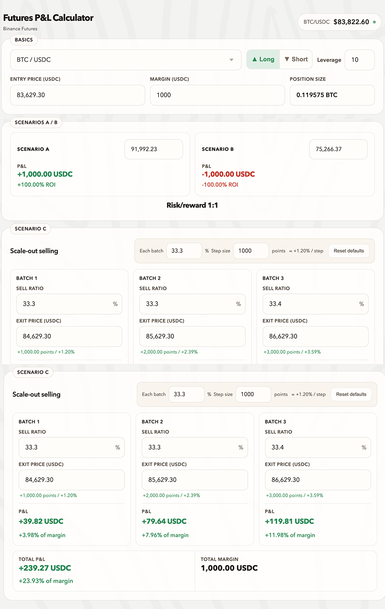

# Margin Muse

**Margin Muse** is a lightweight futures P&L calculator for estimating potential profit, loss, leverage impact, risk/reward, and scale-out selling scenarios.

It is designed for quick trade planning without connecting to a trading account or placing orders.

## Preview

## Features

- Live BTC, ETH, and SOL price lookup
- Long and short position calculations
- Entry price, margin, leverage, and position size inputs
- Side-by-side Scenario A and Scenario B comparison
- Risk-Reward Ratio
- Three-batch scale-out selling planner
- Automatic price updates when the step size changes
- Responsive layout for desktop and mobile screens
- No account login, private API key, or order execution

## Getting Started

No build step or package installation is required.

1. Clone or download this repository.
2. Open `margin-muse.html` in a browser.
3. Enter your trade parameters and review the calculated results.

## Market Data

The calculator use public Real-time Price from Binance:

- Binance Futures API
- Binance Spot API as a fallback

Only public market prices are requested. The application does not access account balances, positions, orders, or private user data.

## Disclaimer

This tool is for calculation and educational purposes only. It does not provide financial advice, guarantee results, or execute trades. Always verify prices, fees, funding rates, and liquidation conditions before making a trading decision.

